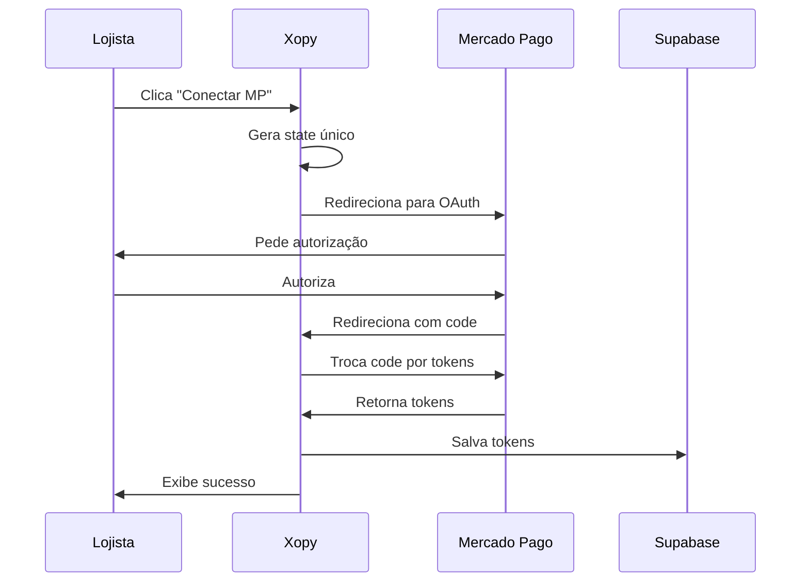
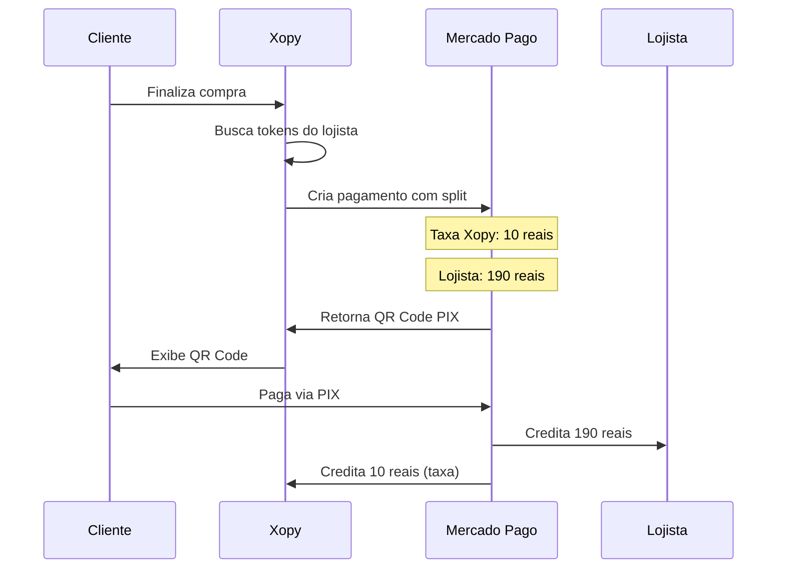

# Integração Mercado Pago - Xopy Marketplace

## 📋 Visão Geral

Este documento descreve a integração completa entre o aplicativo Xopy e o Mercado Pago usando o modelo oficial **Connect (Marketplace)**, com suporte a autenticação OAuth e divisão automática de pagamentos (split).

## 🔑 Credenciais de Teste

```
Public Key: TEST-4346dfab-60be-433c-8b89-511d341d1125
Access Token: TEST-1523898674931437-101510-8e79e01dbdd44758ae467c37a61d70ad-2695399049
Client ID: 1523898674931437
User ID Xopy: 2695399049
```

## 🏗️ Arquitetura

### 1. Banco de Dados (Supabase)

Tabela `mercado_pago_tokens`:
- `id` (UUID) - ID único do registro
- `lojista_id` (UUID) - Referência ao auth.users
- `access_token` (TEXT) - Token de acesso do lojista
- `refresh_token` (TEXT) - Token para renovação
- `user_id_mp` (TEXT) - User ID do Mercado Pago
- `public_key` (TEXT) - Chave pública do lojista
- `expires_in` (INTEGER) - Tempo de expiração em segundos
- `created_at` (TIMESTAMP) - Data de criação
- `updated_at` (TIMESTAMP) - Data de atualização

### 2. Edge Functions

#### `mp-oauth-callback`
**Função**: Processa o callback OAuth do Mercado Pago
**Endpoint**: `/functions/v1/mp-oauth-callback`
**Método**: POST

**Payload**:
```json
{
  "code": "string",
  "state": "string"
}
```

**Fluxo**:
1. Recebe código de autorização
2. Troca código por access_token e refresh_token
3. Salva tokens no Supabase
4. Retorna sucesso

#### `mp-create-payment`
**Função**: Cria pagamento com split automático
**Endpoint**: `/functions/v1/mp-create-payment`
**Método**: POST

**Payload**:
```json
{
  "lojista_id": "uuid",
  "transaction_amount": 200,
  "description": "Descrição do produto",
  "payment_method_id": "pix",
  "payer": {
    "email": "cliente@email.com",
    "first_name": "Nome",
    "last_name": "Sobrenome"
  },
  "marketplace_fee": 10,
  "items": [
    {
      "title": "Produto",
      "quantity": 1,
      "unit_price": 200
    }
  ]
}
```

**Resposta**:
```json
{
  "success": true,
  "payment": {
    "id": "123456789",
    "status": "pending",
    "status_detail": "pending_waiting_payment",
    "transaction_amount": 200,
    "point_of_interaction": {
      "transaction_data": {
        "qr_code": "00020101021...",
        "qr_code_base64": "iVBORw0KGgo..."
      }
    }
  }
}
```

#### `mp-refresh-token`
**Função**: Renova token expirado
**Endpoint**: `/functions/v1/mp-refresh-token`
**Método**: POST

**Payload**:
```json
{
  "lojista_id": "uuid"
}
```

### 3. Componentes React

#### `MercadoPagoConnect`
**Localização**: `src/components/admin/MercadoPagoConnect.tsx`
**Descrição**: Componente para conectar/desconectar conta MP

**Funcionalidades**:
- Botão para conectar conta
- Status da conexão
- Renovação de token
- Desconexão

#### `OAuthCallback`
**Localização**: `src/pages/OAuthCallback.tsx`
**Rota**: `/oauth/callback`
**Descrição**: Página de callback do OAuth

**Fluxo**:
1. Recebe código da URL
2. Valida state (CSRF protection)
3. Chama edge function
4. Exibe status (loading/success/error)
5. Redireciona para admin

### 4. Serviço

#### `mercadoPagoService.ts`
**Localização**: `src/services/mercadoPagoService.ts`

**Funções**:
- `checkMercadoPagoConnection()` - Verifica conexão
- `createPayment(paymentData)` - Cria pagamento
- `refreshToken(lojista_id)` - Renova token
- `initiateMercadoPagoConnect()` - Inicia OAuth

## 🔄 Fluxo de Conexão OAuth



## 💰 Fluxo de Pagamento



## 🚀 Como Usar

### Para Lojistas

1. **Conectar Conta**:
   - Acesse Configurações Admin
   - Clique em "Conectar Mercado Pago"
   - Autorize o acesso
   - Conta conectada!

2. **Verificar Conexão**:
   - Status exibido no painel
   - User ID do MP visível
   - Data de conexão

3. **Renovar Token** (se expirado):
   - Clique em "Renovar Token"
   - Automático via refresh_token

### Para Desenvolvedores

1. **Criar Pagamento**:
```typescript
import { createPayment } from '@/services/mercadoPagoService';

const payment = await createPayment({
  lojista_id: 'uuid-do-lojista',
  transaction_amount: 200,
  description: 'Cimento 50kg',
  payment_method_id: 'pix',
  payer: {
    email: 'cliente@email.com'
  },
  marketplace_fee: 10,
  items: [
    {
      title: 'Cimento 50kg',
      quantity: 1,
      unit_price: 200
    }
  ]
});

console.log('QR Code:', payment.point_of_interaction.transaction_data.qr_code);
```

2. **Verificar Conexão**:
```typescript
import { checkMercadoPagoConnection } from '@/services/mercadoPagoService';

const connection = await checkMercadoPagoConnection();
if (connection.connected) {
  console.log('Conectado:', connection.user_id_mp);
} else {
  console.log('Não conectado');
}
```

## 🔒 Segurança

### CSRF Protection
- State único gerado para cada OAuth
- Validado no callback

### RLS Policies
- Lojistas só veem seus tokens
- Admins têm acesso total
- Service role key em edge functions

### Secrets
- `MP_CLIENT_SECRET` armazenado em Supabase Secrets
- Nunca exposto no frontend

## 📝 Variáveis de Ambiente

### Frontend (.env)
```bash
VITE_SUPABASE_URL=your-supabase-url
VITE_SUPABASE_PUBLISHABLE_KEY=your-anon-key
```

### Supabase Secrets
```bash
MP_CLIENT_SECRET=your-mp-client-secret
SUPABASE_SERVICE_ROLE_KEY=your-service-role-key
```

## 🧪 Testando

### 1. Conectar Conta de Teste
1. Use credenciais de teste do MP
2. Conecte no painel admin
3. Verifique status "conectado"

### 2. Criar Pagamento de Teste
```typescript
const testPayment = await createPayment({
  lojista_id: 'seu-user-id',
  transaction_amount: 100,
  description: 'Teste',
  payment_method_id: 'pix',
  payer: {
    email: 'test@test.com'
  },
  marketplace_fee: 5,
  items: [{
    title: 'Produto Teste',
    quantity: 1,
    unit_price: 100
  }]
});

// Pagar no sandbox do MP
console.log(testPayment.point_of_interaction.transaction_data.qr_code);
```

### 3. Verificar Split
- Acesse dashboard do MP (sandbox)
- Verifique transações
- Confirme split entre lojista e Xopy

## 📚 Recursos

- [Documentação Mercado Pago OAuth](https://www.mercadopago.com.br/developers/pt/docs/mp-connect/authentication)
- [API de Pagamentos](https://www.mercadopago.com.br/developers/pt/reference/payments/_payments/post)
- [Marketplace](https://www.mercadopago.com.br/developers/pt/docs/mp-connect/landing)

## ⚠️ Notas Importantes

1. **Antes de Produção**:
   - Troque credenciais de teste por produção
   - Configure Site URL no Mercado Pago
   - Teste fluxo completo

2. **Renovação de Tokens**:
   - Tokens expiram em ~6 meses
   - Implementar renovação automática
   - Notificar lojista se falhar

3. **Taxas**:
   - Taxa Xopy: Configurável no payment
   - MP cobra taxa adicional do total
   - Documentar claramente para lojistas

4. **Webhooks** (Futuro):
   - Implementar para notificações de pagamento
   - Atualizar status de pedidos
   - Confirmar splits

## 🐛 Troubleshooting

### "Lojista não possui conta MP conectada"
- Verificar se conectou corretamente
- Checar tabela `mercado_pago_tokens`
- Reconectar se necessário

### "Token expirado"
- Usar função `refreshToken()`
- Verificar refresh_token válido
- Reconectar se refresh falhar

### "Erro ao criar pagamento"
- Validar payload completo
- Verificar saldo de teste (sandbox)
- Checar logs da edge function

## 📞 Suporte

Para dúvidas ou problemas:
1. Consulte documentação do MP
2. Verifique logs das edge functions
3. Contate suporte técnico da Xopy
